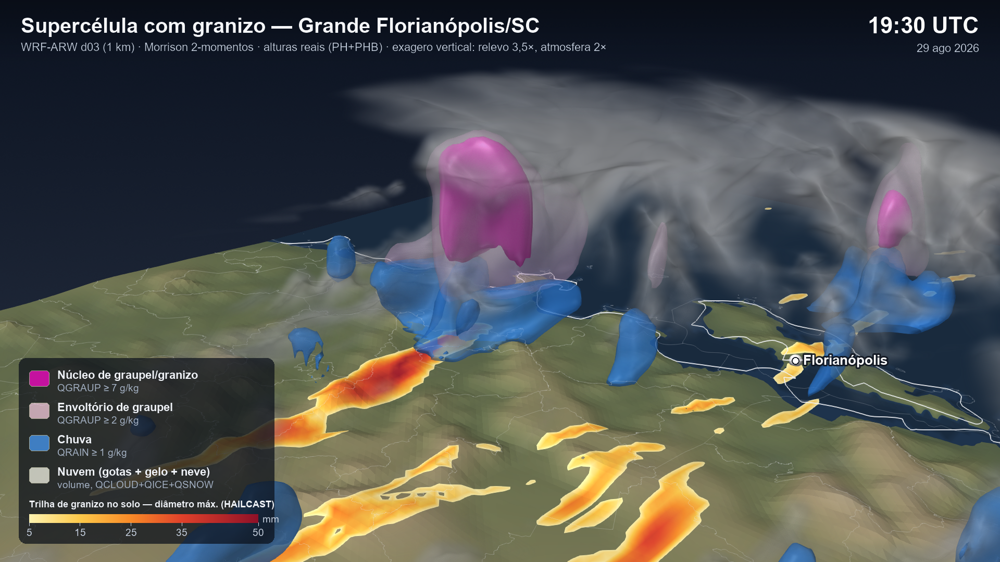

# granizo_gigante

Visualização 3D (ParaView) da supercélula com granizo gigante na Grande Florianópolis/SC,
simulada com o WRF-ARW (domínio d03, 1 km, Morrison 2-momentos), 29 ago 2026.



## Camadas

| Camada | Variável | Cor |
|---|---|---|
| Núcleo de graupel/granizo | QGRAUP ≥ 7 g/kg | magenta opaco |
| Envoltório de graupel | QGRAUP ≥ 2 g/kg | rosa translúcido |
| Chuva | QRAIN ≥ 1 g/kg | azul |
| Nuvem | QCLOUD+QICE+QSNOW (volume) | branco |
| Trilha de granizo no solo | HAILCAST_DIAM_MAX acumulado (5–50 mm) | amarelo → vermelho |

- Campos interpolados dos níveis eta para altura geométrica real (PH+PHB).
- Exagero vertical: relevo 3,5×, atmosfera 2×; perto do solo a atmosfera acompanha o
  relevo, com transição linear até 6 km acima do terreno.
- Limites IBGE reprojetados na LCC do WRF (lon_0 = STAND_LON).

## Como gerar

Requer ParaView 6.2 (`pvpython`, que já inclui netCDF4/VTK) e o `wrfout_d03` da simulação.

```bash
pvpython preparar_dados_granizo.py                                    # gera dados/ (~900 MB, fora do repositório)
pvpython --force-offscreen-rendering renderizar_granizo_3d.py still   # imagens do pico + granizo_3d.pvsm
pvpython --force-offscreen-rendering renderizar_granizo_3d.py anim    # MP4 e GIF 16–23 UTC (precisa de ffmpeg)
```

Os caminhos de entrada (`BASE`, `WRFOUT`, `SHP_DIR`) estão no topo dos scripts.

## Saídas

- `saida/granizo_3d_pico_{sul,sudeste,zoom}.png`
- `saida/granizo_3d_evolucao.mp4` / `.gif`
- `saida/granizo_3d.pvsm` (estado do ParaView; aponta para `dados/` local)
